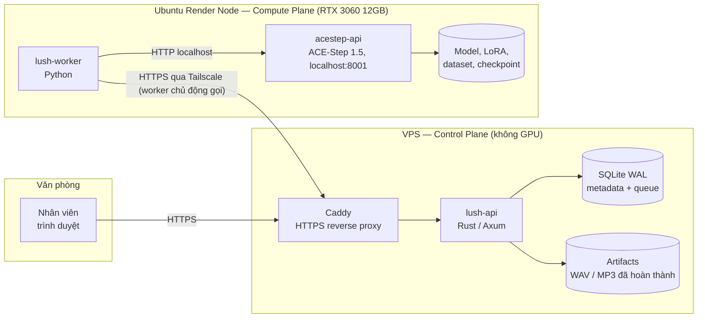
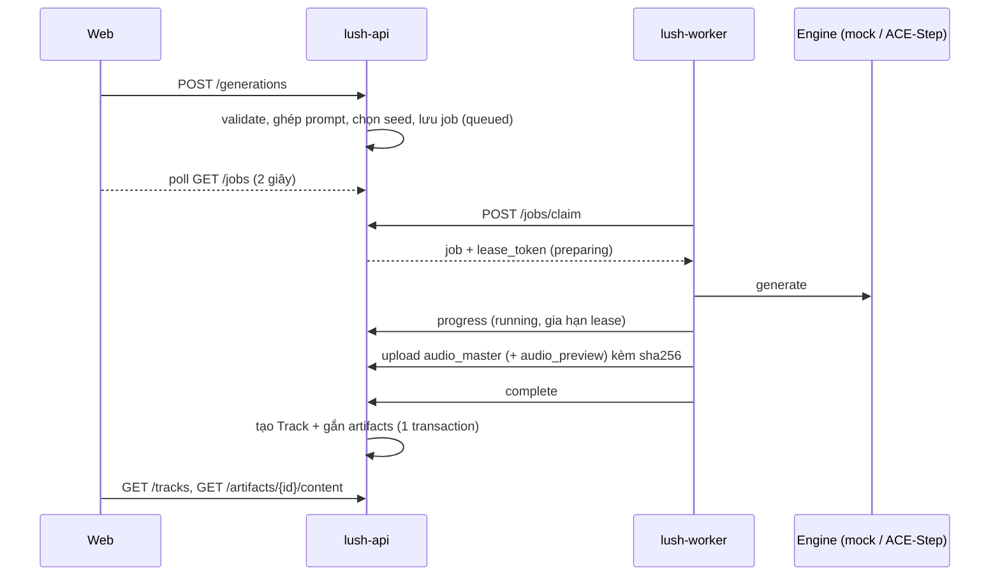

# ARCHITECTURE

## Tổng quan

- **Control Plane** quản lý người dùng, dữ liệu, hàng đợi, registry. Là nguồn dữ liệu nghiệp vụ duy nhất.
- **Compute Plane** chỉ làm inference/training/xử lý audio. Không có database nghiệp vụ, không mở cổng nào ra ngoài.
- Hai bên chỉ nói chuyện qua `docs/WORKER_PROTOCOL.md`. Render Node offline thì website vẫn chạy, job nằm chờ.

## Luồng tạo nhạc

## Thành phần

### `apps/api` — modular monolith

| Module | Trách nhiệm |
|---|---|
| `auth.rs` | Extractor `AuthUser` / `Admin` (cookie phiên) và `NodeAuth` (bearer token của node) |
| `queue.rs` | Kiểu `Job`, phục hồi job (lease hết / node khởi động lại), reaper nền |
| `routes/users.rs` | Đăng nhập, users, projects, audit logs |
| `routes/genres.rs` | Genre Registry, Style Presets |
| `routes/registry.rs` | Model Registry, LoRA Registry, Render Node Registry |
| `routes/jobs.rs` | Tạo generation job (ghép prompt, kiểm tra tương thích), list/cancel/retry |
| `routes/tracks.rs` | Music Library, phát/tải artifact (hỗ trợ Range) |
| `routes/worker.rs` | Worker protocol: register, heartbeat, claim, progress, artifacts, complete/fail/release |

### `workers/music-worker`

`runner.py` (vòng đời: register → heartbeat → claim → chạy → upload → complete) + `engines/` (adapter). Engine được chọn theo `payload.model.engine`. Hiện có `mock` (WAV tổng hợp theo seed, để phát triển không cần GPU) và `acestep` (gọi REST `acestep-api` trên cùng máy).

### `apps/web`

React SPA: Tạo nhạc, Thư viện, Chi tiết track, Hàng đợi, Quản trị (Genres, Presets, Models, Render Nodes, Users, Audit). Player toàn cục. Không hardcode genre/model.

## Scheduling

Capability-based, quyết định ngay trong câu `UPDATE ... WHERE id = (SELECT ...) RETURNING` của `claim` (nguyên tử, không cần lock riêng):

1. Job `queued`, node `active`, không bảo trì, đang rảnh.
2. `job.type` nằm trong `job_types` node báo.
3. Model (và LoRA nếu có) của job đã cài trên node — theo bảng `model_installations` / `lora_installations` do node tự báo khi `register`.
4. `priority` cao trước, rồi tới job cũ hơn.

V1: một job GPU mỗi node. Thêm node = Admin tạo node, lấy token, chạy worker; không đổi code. Node khác GPU/model/engine vẫn đúng vì scheduler chỉ nhìn capability đã báo.

## Độ tin cậy

- **Bền vững**: job nằm trong SQLite; đóng trình duyệt không ảnh hưởng.
- **Lease**: 90 giây, gia hạn qua progress/heartbeat. Hết lease → về hàng đợi (tối đa 3 lượt) hoặc `failed`.
- **Idempotency**: `idempotency_key` phía web; upload artifact và `complete` gọi lại an toàn.
- **Toàn vẹn file**: SHA-256 kiểm tra ở VPS cho mọi upload.
- **Hủy**: job đang chạy được gắn cờ; worker thấy qua progress/heartbeat và xác nhận.

## Bảo mật

Cookie phiên HttpOnly + SameSite=Lax (token lưu dạng SHA-256), mật khẩu Argon2id, RBAC (`admin`/`trainer`/`member`), token node chỉ hiện một lần, audit log cho thao tác quản trị, storage key không nhận input từ client. ACE-Step chỉ nghe `127.0.0.1` trên Render Node. Chi tiết triển khai: `VPS_DEPLOYMENT.md`, `RENDER_NODE_DEPLOYMENT.md`.
