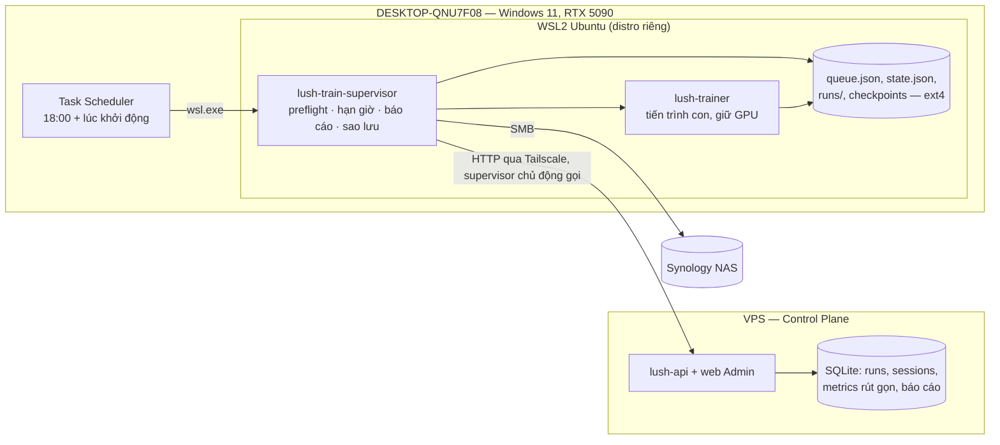

# BASE_MODEL_TRAINING — Overnight full fine-tuning ACE-Step 1.5 Base 2B

> **2026-11-13 — đã dừng (D28).** Phương án điều khiển training từ website được thay bằng workspace độc lập `lush-training/`. Tài liệu này giữ lại để tham khảo; phần supervisor, Task Scheduler, API, web và NAS trong đó không được triển khai. Nguồn hướng dẫn hiện hành: `lush-training/AGENTS.md`.

Ngày: 2026-11-13. Trạng thái: **thiết kế, chưa có code, chưa chạy gì trên máy training.** Chờ người dùng duyệt và trả lời mục 12.

Tài liệu đi kèm (không chép nội dung sang nhau):
- `TRAINING_SCHEDULER.md` — khung giờ 18:00–06:00, kiểm tra máy rảnh, dừng an toàn, phục hồi sau mất điện, cấu hình.
- `TRAINING_TEST_PLAN.md` — giai đoạn kiểm thử khả thi (F0–F7) và mẫu báo cáo.
- `STYLE_TRAINING.md` — Style LoRA trên render node RTX 3060 (hệ thống khác, giữ nguyên).

Nhãn dùng trong ba tài liệu: **[Đo]** số đo thật có ngày · **[Source]** đọc từ code ACE-Step `ca1e85f` trên `render-node-01` · **[Tài liệu]** bên thứ ba công bố, ta chưa kiểm · **[Ước tính]** phép tính của ta, chưa đo · **[Đề xuất]** thiết kế chưa làm · **[Tạm]** giá trị khởi điểm, thay bằng số đo sau kiểm thử · **[Chưa rõ]** chưa có bằng chứng.

## 1. Mục tiêu và nguyên tắc

Mục tiêu: full fine-tuning ACE-Step 1.5 **Base 2B**, cập nhật 100% tham số DiT, chạy qua đêm trên máy training riêng, quản lý từ website.

Máy training (theo người dùng cung cấp, chưa kiểm trực tiếp): `DESKTOP-QNU7F08`, Windows 11, i7-13700K, RAM 128 GB DDR4, RTX 5090 32 GB. Khung giờ 18:00–06:00 Asia/Ho_Chi_Minh.

Môi trường training (người dùng chốt 2026-11-13, D24): **WSL2 Ubuntu** trên Windows 11, Python + PyTorch + CUDA bản hỗ trợ RTX 5090. Không cài lại Windows, không đổi phân vùng ổ cứng. Trainer và supervisor là tiến trình Linux trong WSL2; Windows chỉ giữ vai trò kích hoạt (Task Scheduler). Chi tiết và các điểm phải kiểm của WSL2: `TRAINING_SCHEDULER.md` mục 2.

Nguyên tắc (người dùng đặt, áp dụng cho mọi module):
1. Không làm gián đoạn công việc ban ngày: ngoài khung giờ không có tiến trình nào của hệ thống giữ GPU.
2. Không tự tắt máy, reboot, hay kill ứng dụng của người dùng. Máy bận thì **chờ hoặc bỏ đêm đó**, ghi vào báo cáo.
3. Không tự đổi training method. Không dùng LoRA thay thế. Nếu full fine-tuning không khả thi: dừng, viết báo cáo kỹ thuật, chờ quyết định.
4. Training Worker chạy độc lập với Claude Code và với website: VPS mất mạng thì đêm đó vẫn train theo hàng đợi đã lưu trên máy.

Ngoài phạm vi: vocal (D22 vẫn giữ: chỉ instrumental), cloud, train LM / text encoder / VAE, tự động duyệt hay tự đưa model vào production.

## 2. Hiện trạng source liên quan

| Hạng mục | Hiện trạng | Nguồn |
|---|---|---|
| Hàng đợi, lease, worker protocol, registry, trang Train Style | Có, đã chạy thật cho `train_lora` trên máy dev; chưa deploy | `STYLE_TRAINING.md` mục 13, `tasks/CURRENT.md` T-008 |
| Trainer hiện có (`workers/music-worker/.../training.py`) | Chỉ bọc Side-Step LoRA; gọi `systemctl --user`; một run = một job, `max_attempts = 1`, hết giờ là kết thúc run | [Source] repo |
| Full fine-tune trong ACE-Step `ca1e85f` | **Không có.** `load_decoder_for_training` đóng băng mọi tham số, trainer chỉ mở tham số LoRA. Hướng dẫn upstream: "Full-parameter SFT is NOT natively supported", kèm bản vá mẫu chưa merge | [Source] `training_v2/model_loader.py:176`, `docs/en/Large_Scale_SFT_Training_Guide.md:437` |
| Checkpoint của Side-Step | Adapter + optimizer + scheduler + epoch/step. **Không có RNG.** Chỉ ghi cuối epoch. Không có signal handler: dừng giữa chừng là mất | [Source] `trainer_helpers.py:187`; [Đo] E1 2026-11-13 |
| Resume của Side-Step | Checkpoint hỏng → in cảnh báo rồi **train lại từ đầu, exit 0** | [Source] |
| Validation loss | Không trainer nào có | [Source] |
| Kích thước model 2B | Tổng 2.393.872.518 tham số, lưu bf16 (4,79 GB). `decoder` (DiT) **1.575.458.880**; `encoder` 608.367.616; `tokenizer` 105.032.198; `detokenizer` 105.011.776 | [Đo] 2026-11-13, đọc header `acestep-v15-turbo/model.safetensors` |
| Checkpoint `acestep-v15-base` | Chưa có trên máy nào của ta. Kiến trúc được coi là giống turbo (cùng "2B") nhưng **chưa kiểm** | [Chưa rõ] |
| Máy training | Windows 11 (người dùng cho biết). Chưa có gì cài; chưa biết WSL2 đã bật chưa, đĩa, driver, cách truy cập | [Chưa rõ] |

Hệ quả:
- Không dùng lại được `training.py` hay Side-Step cho việc này. Phải viết **trainer riêng** (mục 4) và **supervisor riêng** (`TRAINING_SCHEDULER.md`).
- Mô hình "một run = một job có lease" không hợp: một run kéo dài nhiều đêm. Cần khái niệm run / session (mục 6).
- D22 ("chỉ RTX 3060, ưu tiên Style LoRA, full fine-tuning chỉ đề xuất khi có trainer và bằng chứng tài nguyên") được D24 mở rộng: có máy mới và người dùng yêu cầu full fine-tuning; bằng chứng tài nguyên là việc của giai đoạn kiểm thử.

## 3. Khả thi trên 32 GB — phép tính, chưa phải kết quả

"100% tham số DiT" trong tài liệu này = toàn bộ `decoder` (1,575 tỷ tham số). `encoder` (condition encoder), `tokenizer`, `detokenizer`, VAE, text encoder đóng băng, đúng như cả hai trainer upstream ("Chỉ DiT decoder"). Cần người dùng xác nhận định nghĩa này (Q2).

Bộ nhớ GPU cho phần cố định, chưa tính activation [Ước tính, 1 GB = 10⁹ byte]:

| Cấu hình | Trọng số | Gradient | Trạng thái optimizer | Tổng cố định |
|---|---|---|---|---|
| A. fp32 + AdamW (chuẩn) | 6,3 GB | 6,3 GB | 12,6 GB | **25,2 GB** |
| B. fp32 + AdamW 8-bit (`bitsandbytes`) | 6,3 | 6,3 | ~3,2 | ~15,8 GB |
| C. fp32 + Adafactor | 6,3 | 6,3 | nhỏ | ~12,6 GB |

Cộng thêm: activation (phụ thuộc độ dài segment, batch, gradient checkpointing — chưa đo cho full fine-tune), thành phần đóng băng còn nằm trên GPU, và phần Windows + màn hình đang dùng. E1 trên 3060 đo ~5 GB đỉnh cho LoRA segment 60 giây, nhưng con số đó gồm trọng số bf16 nên không cộng thẳng vào bảng này được.

Nhận định: cấu hình A **sát ngưỡng** 32 GB, có thể không vừa; B và C có khả năng vừa. Cả ba đều cập nhật 100% tham số DiT, khác nhau ở optimizer. Việc chọn A/B/C là quyết định của người dùng sau khi có số đo F2 (Q3) — hệ thống không tự chuyển.

Lưu ý về độ chính xác: trọng số huấn luyện giữ fp32, tính toán forward dùng autocast bf16. Train thẳng trên trọng số bf16 với learning rate cỡ 1e-5 làm mất phần lớn bước cập nhật do làm tròn, nên không đưa vào danh sách.

Bảng yêu cầu "tối thiểu 8 × 40 GB" trong hướng dẫn upstream [Tài liệu] viết cho batch 8/GPU trên 116 nghìn bài, và ghi decoder "~3,5B" — không khớp số đo 1,575B của bản 2B. Nó không chứng minh được cũng không bác bỏ được trường hợp một GPU, batch 1.

Rủi ro không phụ thuộc VRAM:
- **Dataset nhỏ + full fine-tune → quên kiến thức cũ / học thuộc.** Upstream xếp nguy cơ catastrophic forgetting của full SFT là "High" [Tài liệu]. Kích thước dataset thật chưa biết (Q4). Giai đoạn kiểm thử chỉ trả lời "có chạy được không", không trả lời "model có hay hơn không".
- Tốc độ mỗi step chưa biết → chưa ước lượng được một run mất bao nhiêu đêm.

## 4. Trainer `lush-trainer` [Đề xuất]

Gói Python mới `workers/train-worker/` (tách khỏi `music-worker` vì khác máy, khác môi trường, khác vòng đời). Chạy trong venv của một bản ACE-Step cài trên máy training, **ghim commit**; không sửa file nào trong checkout ACE-Step.

Dùng lại từ ACE-Step (import, không chép): nạp model (`AutoModel.from_pretrained`), preprocessing ra tensor `.pt`, data module, hàm lấy mẫu timestep liên tục + CFG dropout và phép tính loss flow-matching của chế độ `fixed`. Tự viết: vòng lặp train, checkpoint, resume, validation, dừng an toàn, xuất model.

Khác biệt bắt buộc so với Side-Step:

| Việc | Cách làm |
|---|---|
| Tham số được train | Không inject adapter. `requires_grad = True` cho mọi tham số `decoder`, `False` cho phần còn lại. Lúc khởi động in và ghi `trainable / total`; khác 1.575.458.880 thì dừng |
| Đơn vị tiến độ | **Optimizer step**, không phải epoch. Checkpoint, validation, dừng đều ở ranh giới step |
| Checkpoint | Mỗi `save_every_steps` **và** mỗi `save_every_minutes`, và khi dừng. Định dạng ở mục 5 |
| Dừng an toàn | Sau mỗi optimizer step kiểm tra: file `STOP` trong thư mục run, và hạn `--stop-at` do supervisor truyền. Có thì lưu checkpoint rồi thoát với mã riêng. `SIGTERM` cũng được xử lý như yêu cầu dừng, nhưng hạn giờ không phụ thuộc signal: trainer tự biết `--stop-at` |
| Resume | Chỉ từ checkpoint có `MANIFEST.json` hợp lệ và khớp SHA-256. Không hợp lệ → thử checkpoint liền trước → không còn thì **thoát lỗi**. Không bao giờ âm thầm train lại từ đầu |
| Lịch learning rate | Định nghĩa theo `total_steps` cố định ghi trong `run.json`; resume không đổi được. "Train thêm" là run mới khởi đầu từ weights của run cũ |
| RNG | Generator riêng cho noise/timestep và cho thứ tự mẫu; lưu cùng checkpoint (mục 5) |
| Validation loss | Tập validation cố định (split theo nhóm tác phẩm, `STYLE_TRAINING.md` 12.2), bộ timestep + noise cố định theo seed, tính mỗi `validate_every_steps`. Đây là phần ta thêm; upstream không có nên không có số tham chiếu |
| Lỗi số học | Loss không hữu hạn → dừng ngay, **không** ghi checkpoint mới, giữ checkpoint tốt gần nhất |
| OOM | Thoát với mã riêng; supervisor không thử lại với cấu hình khác |
| Số liệu | `metrics.jsonl` mỗi step: step, loss, lr, grad norm, giây/step, VRAM đang dùng/đỉnh (`torch.cuda.max_memory_allocated` + `nvidia-smi`), RAM tiến trình |

Mã thoát của trainer (supervisor dựa vào đây, không đoán từ log): `0` xong run · `10` dừng theo hạn giờ, đã lưu · `11` dừng theo yêu cầu, đã lưu · `20` OOM · `21` loss không hữu hạn · `22` không có checkpoint hợp lệ để resume · `23` cấu hình/dataset/checkpoint gốc không khớp `run.json` · khác: crash.

Xuất model: thư mục variant đầy đủ để `acestep-api` nạp như một model (`config.json`, file modeling, `silence_latent.pt`, `model.safetensors` với `decoder` đã train, các thành phần khác chép nguyên từ base và kiểm trùng byte). Tên dạng `lush-v15-base-<key>-v<N>`. Cách nạp vào inference và máy nào chạy inference cho model mới: chưa thiết kế (Q9).

## 5. Checkpoint và lưu trữ [Đề xuất]

`<TRAIN_ROOT>` nằm **trong hệ file ext4 của distro WSL2** (ví dụ `/srv/lush-train`), không nằm dưới `/mnt/c`: truy cập ổ Windows từ WSL2 chậm và không giữ đúng ngữ nghĩa rename/fsync mà cách ghi nguyên tử bên dưới dựa vào. Đĩa ảo của distro là một file `.vhdx` trên ổ NTFS sẵn có nên không đụng tới phân vùng; đặt nó ở ổ nào quyết định sau F0.

```
<TRAIN_ROOT>/
  ACE-Step-1.5/                      # checkout ghim commit + venv
  checkpoints/acestep-v15-base/      # checkpoint gốc, chỉ đọc
  datasets/<name>/<version>/         # audio/, dataset.json, manifest
  tensors/<dataset>-<version>-<khóa>/
  runs/<run_id>/
    run.json                         # bất biến: config, dataset version + hash, SHA-256 base,
                                     # commit ACE-Step, seed, total_steps
    LATEST                           # tên checkpoint hợp lệ mới nhất (ghi bằng rename nguyên tử)
    checkpoints/step-00001200/
      decoder.safetensors            # 100% tham số DiT, fp32
      optimizer.pt  scheduler.pt
      rng.pt                         # python, numpy, torch CPU, torch CUDA, generator noise, generator sampler
      progress.json                  # step, epoch, vị trí trong epoch, tổng giây train, session
      MANIFEST.json                  # kích thước + SHA-256 từng file; ghi SAU CÙNG
    sessions/<YYYY-MM-DD>/           # session.json, train.log, metrics.jsonl, gpu.csv, report.md
    export/                          # model hoàn chỉnh khi run xong
  queue.json  state.json  logs/      # của supervisor
```

- **Ghi nguyên tử:** ghi vào `step-N.partial/`, flush + fsync từng file, tính SHA-256, ghi `MANIFEST.json`, đổi tên thư mục, rồi mới cập nhật `LATEST`. Mất điện ở bất kỳ điểm nào cũng để lại checkpoint cũ còn nguyên; thư mục `.partial` bị xóa ở lần khởi động sau.
- **Giữ lại:** 2 checkpoint resume đầy đủ gần nhất + checkpoint mốc (chỉ `decoder.safetensors`, mỗi `milestone_every_steps`) để đánh giá. Xóa cái cũ chỉ sau khi cái mới đã kiểm xong.
- **Dung lượng [Ước tính]:** checkpoint đầy đủ ≈ 6,3 GB (decoder) + trạng thái optimizer (12,6 GB với AdamW chuẩn; ~3 GB với 8-bit) ≈ 9–19 GB. Mốc ≈ 6,3 GB mỗi cái. Thời gian ghi: đo ở F4.
- `optimizer.pt`/`rng.pt` là pickle: chỉ nạp file do chính hệ thống ghi, đã khớp SHA-256 trong manifest.
- Mọi thứ nằm trên máy training và NAS; không đi qua VPS (D9).

### Sao lưu Synology NAS

Sau mỗi session, **sau khi trainer đã thoát và GPU đã trả** (sao lưu không cần GPU, được phép chạy quá 06:00 nếu người dùng đồng ý — Q6):
1. Chép checkpoint resume mới nhất, các mốc mới, `run.json`, log, báo cáo sang share SMB trên NAS vào thư mục `.partial`.
2. Đọc lại từ NAS, so SHA-256 với manifest, rồi đổi tên.
3. Ghi trạng thái từng checkpoint: `local` / `backing_up` / `backed_up` / `backup_failed`.

NAS không tới được → session vẫn tính là thành công, sao lưu `backup_failed`, thử lại đêm sau, hiện cảnh báo trên web. Giữ trên NAS: checkpoint resume mới nhất của mỗi run + mọi mốc + model export. Thông tin đăng nhập NAS lưu trong một file riêng trong distro (quyền `600`, ngoài repo), không nằm trong file cấu hình hay Markdown. Địa chỉ, share, hạn mức: Q6.

## 6. Kiến trúc tổng thể [Đề xuất]



Ba lớp, mỗi lớp sống được khi lớp trên mất:
- **Trainer** chỉ biết một run, một thư mục, một hạn giờ. Không biết mạng, không biết web.
- **Supervisor** (tiến trình Python thường trú trong khung giờ) quyết định có train không, train run nào, khi nào dừng; là nguồn sự thật về **việc đang chạy**. Chi tiết ở `TRAINING_SCHEDULER.md`.
- **Control Plane** là nguồn sự thật về **ý định của Admin** (hàng đợi, thứ tự, tạm dừng, hủy) và nơi xem kết quả. Supervisor đồng bộ định kỳ; lệnh từ web có hiệu lực ở lần đồng bộ kế tiếp (≤ 1 phút khi đang online).

Vẫn giữ quy tắc kiến trúc hiện có: worker chủ động gọi VPS, VPS không gọi vào node; worker không đụng database.

### Run, session, hàng đợi

- **Run** = (dataset version, base model version, cấu hình, `total_steps`). Trạng thái: `queued → active ⇄ paused → completed | failed | cancelled`. `failed` chỉ khi lỗi cần người xem (OOM, loss không hữu hạn, checkpoint hỏng hết, dataset không khớp).
- **Session** = một lần chạy trong một đêm của một run. Kết thúc với `stop_reason`: `window_end`, `completed`, `stop_requested`, `machine_busy` (không bắt đầu), `error`, `interrupted` (mất điện/crash, phát hiện ở lần khởi động sau).
- **Hàng đợi:** danh sách run có thứ tự do Admin đặt. Mỗi đêm supervisor lấy run `active` đang dở; không có thì lấy run `queued` đầu tiên. Run xong giữa đêm → chuyển sang run kế tiếp nếu còn đủ thời gian tối thiểu. Một GPU, một run tại một thời điểm.
- **Base model version:** run có thể khởi đầu từ checkpoint gốc hoặc từ model export của một run trước (ghi SHA-256 nguồn vào `run.json`).

### Hợp đồng và schema — chỉ là đề xuất

Khi triển khai mới ghi vào `WORKER_PROTOCOL.md`, `API_CONTRACTS.md`, `DATABASE.md` cùng thay đổi code. Hướng dự kiến:

- Không nhét vào bảng `jobs`: lease 90 giây và `max_attempts` được thiết kế cho việc ngắn; run nhiều đêm cần bản ghi riêng. Bảng mới `model_training_runs`, `model_training_sessions`, `model_training_checkpoints`; dùng lại `training_metrics` nếu thêm được khóa theo run (quyết định khi viết migration).
- Worker protocol thêm một endpoint đồng bộ, ví dụ `POST /api/worker/training/sync`: node gửi trạng thái supervisor, session hiện tại, metrics mới (theo `sequence`, gửi lại không tạo trùng), checkpoint và trạng thái sao lưu; nhận về hàng đợi mong muốn và lệnh (`pause`, `resume`, `cancel`, `stop_now`). Node đăng ký như một node có `job_types = ["train_model"]`, không nhận job generate.
- API web (chỉ `admin`): tạo / sửa thứ tự / tạm dừng / tiếp tục / hủy run; "Dừng ngay"; xem session, metrics, checkpoint, báo cáo.

## 7. Admin trên website [Đề xuất]

Mục mới **Train Model** trong Admin (theo D23: "model" là base model; "Train Style" là LoRA, giữ nguyên trang cũ). Dùng lại thành phần sẵn có (`ui.tsx`, `LossChart`, bảng admin).

| Màn | Nội dung |
|---|---|
| Tổng quan | Trạng thái node (online / đang train / chờ máy rảnh / ngoài khung giờ / mất cập nhật từ …), run đang chạy, step hiện tại / tổng, đêm gần nhất, cảnh báo (sao lưu lỗi, đĩa sắp đầy, đêm bị bỏ) |
| Hàng đợi | Danh sách run: dataset version, base model version, cấu hình; tạo, sắp thứ tự, tạm dừng, tiếp tục, hủy |
| Chi tiết run | Biểu đồ train loss, validation loss, learning rate; VRAM, RAM; danh sách session; danh sách checkpoint kèm trạng thái kiểm tra và sao lưu NAS; nút "Dừng ngay" |
| Báo cáo đêm | Báo cáo từng session (mục 8) |

Mỗi màn có đủ trạng thái rỗng / đang tải / mất cập nhật / lỗi. Giá trị chưa có hiện "Chưa có dữ liệu", không hiện số 0. Tạo run có bước xác nhận hiển thị rõ: đây là full fine-tuning, chạy trong khung giờ, ước lượng số đêm (chỉ hiện khi đã có tốc độ đo thật).

## 8. Báo cáo sau mỗi đêm

Supervisor sinh `sessions/<ngày>/report.md` + bản JSON, gửi lên VPS ở lần đồng bộ kế tiếp. Mọi số lấy từ `metrics.jsonl`, `gpu.csv`, manifest; không nội suy. Nội dung:

- Run, dataset version, base model version, cấu hình (tham chiếu `run.json`).
- Giờ bắt đầu thật, giờ bắt đầu dừng, giờ GPU được trả, `stop_reason`. Nếu không train: lý do (máy bận — tiến trình nào, VRAM bao nhiêu; không có run; lỗi).
- Step đầu → step cuối, số step trong đêm, giây/step (trung vị, p95), ước lượng số đêm còn lại.
- Train loss (đầu, cuối, trung bình trượt), validation loss tại các mốc, learning rate.
- VRAM đỉnh, RAM đỉnh, nhiệt độ GPU đỉnh, đĩa còn trống.
- Checkpoint đã ghi: step, dung lượng, thời gian ghi, kết quả kiểm SHA-256, trạng thái sao lưu NAS.
- Sự cố: OOM, loss không hữu hạn, resume từ checkpoint nào, session trước bị ngắt.
- Việc cần người xem.

## 9. Các module cần bổ sung

| Lớp | Module | Việc |
|---|---|---|
| Training node | `workers/train-worker/src/lush_trainer/` (mới) | Trainer: vòng lặp, checkpoint, resume, validation, dừng an toàn, export (mục 4–5) |
| | `workers/train-worker/src/lush_train_supervisor/` (mới) | Khung giờ, preflight, chạy trainer, hạn giờ, phục hồi, báo cáo, sao lưu NAS, đồng bộ VPS |
| | `infrastructure/train-node/` (mới) | Script cài đặt, định nghĩa task của Task Scheduler, file cấu hình mẫu |
| API | migration mới, `routes/model_training.rs`, `routes/worker.rs` | Run / session / checkpoint, endpoint đồng bộ, lệnh |
| Web | `pages/admin/model-training/*`, `api/*`, `Sidebar` | Mục 7 |
| Docs | Hai file hợp đồng, `DATABASE.md`, `TESTING.md`, `ARCHITECTURE.md` | Cùng thay đổi code |

Không sửa: `music-worker`, luồng `train_lora`, luồng tạo nhạc, checkout ACE-Step.

## 10. Thứ tự triển khai

| Giai đoạn | Phạm vi | Điều kiện xong |
|---|---|---|
| P0 | Ba tài liệu này | Người dùng duyệt, trả lời mục 12 |
| P1 | Kiểm thử khả thi bằng tay trên máy training (`TRAINING_TEST_PLAN.md` F0–F5) | Báo cáo khả thi có số đo; người dùng chọn cấu hình optimizer hoặc quyết định dừng |
| P2 | `lush-trainer` + supervisor + Task Scheduler, chạy độc lập, điều khiển bằng file và dòng lệnh; báo cáo đêm trên máy | F6–F7 đạt: nhiều đêm liên tiếp, có diễn tập mất điện |
| P3 | API + web Admin + đồng bộ | Tạo run, đổi thứ tự, tạm dừng, xem số liệu từ web trên run thật |
| P4 | Sao lưu NAS | Khôi phục thử một run từ NAS sang thư mục trống và resume được |
| P5 | Đánh giá và đưa model vào inference | Thiết kế riêng sau, dựa trên `STYLE_TRAINING.md` mục 8 và 12.3 |

P1 phải xong trước khi viết code P2: nếu không khả thi thì dừng ở báo cáo (nguyên tắc 3). Mỗi lần tải model và mỗi lần train thật cần người dùng đồng ý, như quy định hiện có.

## 11. Rủi ro đã biết

| Rủi ro | Xử lý trong thiết kế |
|---|---|
| Không vừa 32 GB với AdamW chuẩn | Đo F2 theo thứ tự A → B → C, báo cáo, người dùng chọn |
| Dataset nhỏ làm hỏng model | Validation loss + mốc checkpoint để nghe; cảnh báo ở bước tạo run; không tự duyệt |
| Người dùng cần máy giữa đêm | "Dừng ngay" trên web và lệnh trên máy; GPU trả trong thời gian đã đo ở F4 |
| Mất điện giữa lúc ghi checkpoint | Ghi nguyên tử + manifest + giữ 2 bản |
| Ghi checkpoint lâu hơn dự kiến → lấn quá 06:00 | Hạn dừng tính từ số đo F4 nhân hệ số; quá hạn cứng thì supervisor kết thúc **tiến trình trainer của chính nó** (không đụng tiến trình khác) và ghi sự cố |
| Resume không tái lập bit-exact trên GPU | Lưu đủ RNG; tiêu chí F5 quy định mức chấp nhận, báo cáo đúng mức đạt được |
| Windows Update tự khởi động lại máy trong đêm | Không tự đổi cấu hình hệ điều hành; coi như mất điện (resume đêm sau); ghi vào báo cáo; hướng dẫn người dùng đặt giờ hoạt động nếu muốn |
| Đĩa đầy | Preflight kiểm dung lượng theo kích thước checkpoint đo thật; chính sách giữ lại ở mục 5 |
| WSL2 giới hạn RAM (mặc định một phần RAM máy) và giữ RAM sau khi train xong, làm chậm việc ban ngày | Đo ở F0/F2; sau mỗi session tắt **riêng distro training**; mọi thay đổi `.wslconfig` cần người dùng đồng ý (`TRAINING_SCHEDULER.md` mục 2) |
| File `.vhdx` của distro chỉ lớn lên, không tự co lại khi xóa checkpoint | Theo dõi trong báo cáo đêm; thu gọn là thao tác tay, cần đồng ý |
| Mất điện làm hỏng dữ liệu trong `.vhdx` dù đã fsync | [Chưa rõ] WSL2 chuyển fsync xuống đĩa thật tới mức nào; giữ 2 checkpoint + bản NAS; diễn tập ở F6 |

## 12. Cần người dùng trả lời

Theo thứ tự ảnh hưởng tới thiết kế:

- **Q1. Claude Code truy cập máy training bằng cách nào** (SSH, Tailscale, hay chạy Claude Code ngay trên máy đó)? Hệ điều hành đã rõ: Windows 11 + WSL2 Ubuntu. Còn cần biết: WSL2 đã bật chưa, máy có đang dùng WSL / Docker Desktop cho việc khác không (để hệ thống không đụng vào), và tin nhắn bổ sung ngày 2026-11-13 bị cắt ở mục "Kiểm tra" — phần sau chưa nhận được.
- **Q2.** "100% tham số DiT" = toàn bộ `decoder` (1,575 tỷ), đóng băng condition encoder / tokenizer / VAE / text encoder — đúng ý chưa?
- **Q3.** Nếu AdamW chuẩn không vừa 32 GB: AdamW 8-bit hoặc Adafactor (vẫn cập nhật 100% tham số) có được coi là cùng training method không, hay mỗi lựa chọn cần duyệt riêng? Mặc định trong thiết kế: **cần duyệt riêng**.
- **Q4.** Dataset: bao nhiêu bài / bao nhiêu giờ, quyền sử dụng, đang nằm ở đâu? Ảnh hưởng trực tiếp tới việc full fine-tune có ý nghĩa hay không.
- **Q5.** Đồng ý tải về máy training: ACE-Step (code), `acestep-v15-base`, VAE, `Qwen3-Embedding-0.6B`? Dung lượng `base` chưa kiểm (turbo cùng kiến trúc là 4,8 GB; VAE 0,3 GB; text encoder 1,2 GB [Đo trên render node]).
- **Q6.** NAS: địa chỉ, share, hạn mức dung lượng, tài khoản; sao lưu có được chạy sau 06:00 không (không dùng GPU, có dùng đĩa và mạng)?
- **Q7.** Ban đêm máy có khi nào chạy việc khác không (render, game, tải file)? Ngưỡng "máy rảnh" ở `TRAINING_SCHEDULER.md` mục 4 đang là giá trị tạm.
- **Q8.** Máy có tự bật lại sau khi có điện (BIOS "Restore on AC power loss") và có cho chạy task khi chưa ai đăng nhập không (WSL2 gắn với tài khoản người dùng; chạy được khi chưa đăng nhập hay không phải thử ở F0)? Thiếu hai điều này thì "resume sau mất điện" chỉ xảy ra khi có người bật máy và đăng nhập.
- **Q9.** Model sau khi train sẽ chạy inference ở đâu (render node RTX 3060 hay máy 5090)? Ảnh hưởng P5, không chặn P1–P4.
