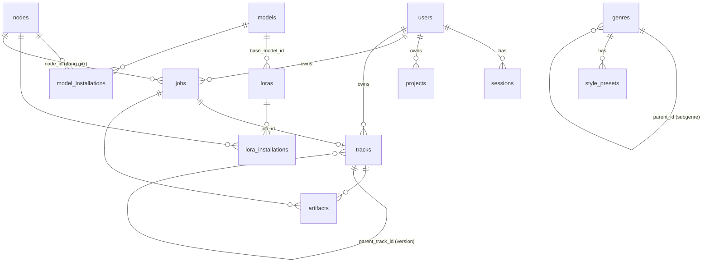

# DATABASE

SQLite (WAL, `foreign_keys = ON`), một file `DATA_DIR/lush.db`. Schema đầy đủ và chú thích: `apps/api/migrations/0001_init.sql`. Migrations chạy tự động khi `lush-api` khởi động; **không sửa migration đã phát hành**, luôn thêm file mới.

Quy ước: `id` là TEXT (UUID v7), thời gian là TEXT UTC `YYYY-MM-DDTHH:MM:SS.sssZ` (so sánh chuỗi được), cột JSON là TEXT.

| Bảng | Vai trò |
|---|---|
| `users`, `sessions` | Tài khoản, vai trò, phiên đăng nhập (lưu SHA-256 của token) |
| `projects` | Nhóm track theo dự án |
| `genres` | Genre Registry; subgenre là dòng có `parent_id` |
| `style_presets` | Genre preset (`kind=genre`) và trained style preset (`kind=trained`, có `lora_id`) |
| `models`, `loras` | Registry (chỉ metadata; weights nằm trên Render Node) |
| `nodes` | Render Node Registry + heartbeat gần nhất |
| `model_installations`, `lora_installations` | Node nào có model/LoRA nào — do node tự báo |
| `jobs` | Hàng đợi bền vững cho mọi loại job; `request` = body người dùng gửi, `payload` = dữ liệu gửi cho worker |
| `tracks` | Music Library; xóa mềm qua `deleted_at` |
| `artifacts` | File theo ID; `storage_key` tương đối so với `DATA_DIR`, không bao giờ trả ra API |
| `audit_logs` | Nhật ký thao tác quản trị và đăng nhập |

Chỉ mục đáng chú ý: `jobs_queue_idx (status, priority DESC, created_at)` cho claim; `jobs_idempotency_idx` (unique theo `owner_id, idempotency_key`) chống tạo job trùng; `artifacts (job_id, kind)` unique để upload lại là ghi đè.

Sao lưu: xem `VPS_DEPLOYMENT.md`. Chuyển PostgreSQL: xem D2 trong `DECISIONS.md`.
