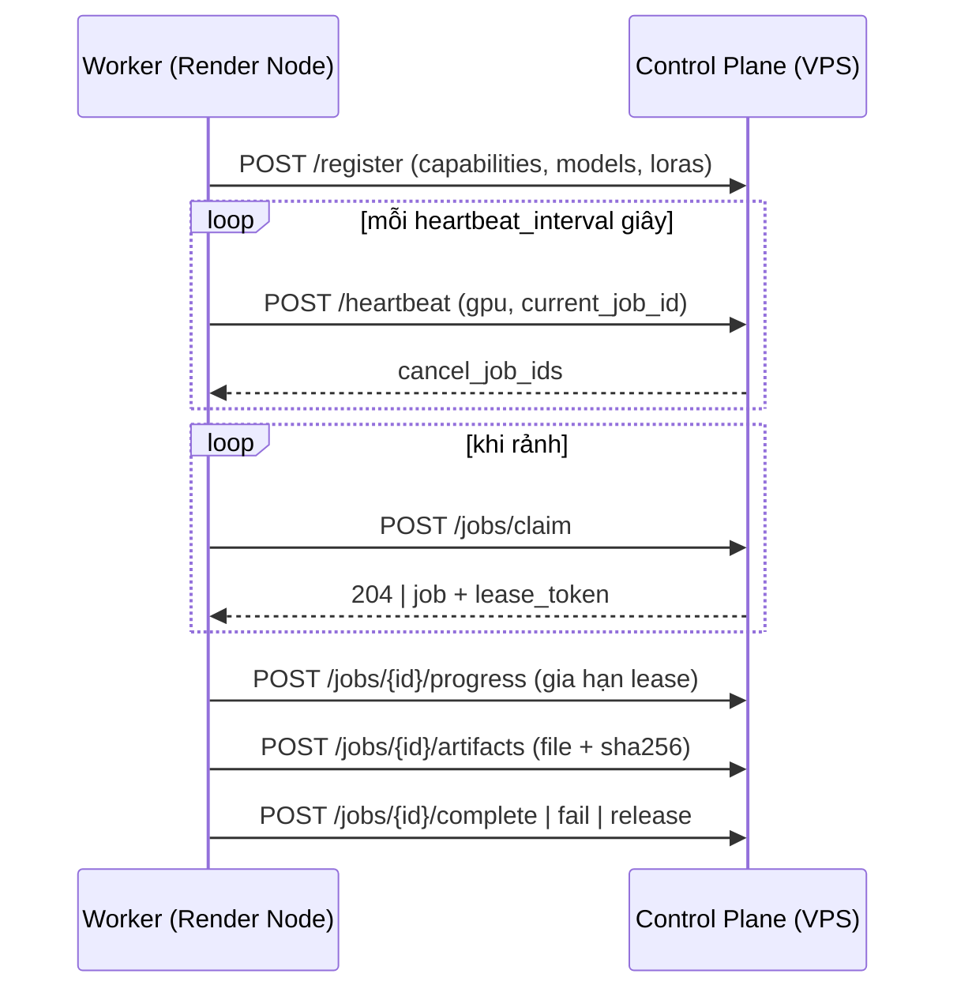
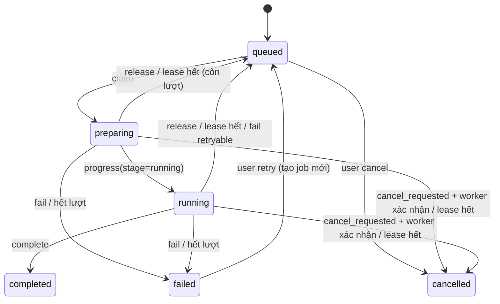

# WORKER_PROTOCOL — Giao thức Render Node ↔ Control Plane

Phiên bản giao thức: `1` (`protocol_version`). Worker luôn **chủ động** gọi tới VPS (pull); VPS không bao giờ gọi vào Render Node.

- Base path: `/api/worker/v1`
- Xác thực: header `Authorization: Bearer <node_token>`. Token do Admin tạo khi thêm node (chỉ hiện một lần, VPS chỉ lưu SHA-256).
- Node bị `disabled` → mọi request trả `403 node_disabled`.
- Lỗi luôn có dạng `{"error": {"code": "...", "message": "..."}}`.
- Thời gian: chuỗi UTC `YYYY-MM-DDTHH:MM:SS.sssZ`. ID: chuỗi UUID.

## Vòng đời



## Endpoints

### `POST /register`
Gọi khi worker khởi động (`fresh_start: true`) và gọi lại định kỳ để cập nhật capabilities (`fresh_start: false`).

```json
{
  "protocol_version": 1,
  "worker_version": "0.1.0",
  "fresh_start": true,
  "job_types": ["generate"],
  "engines": [{"name": "mock", "version": "1", "capabilities": ["generate"]}],
  "models": [{"engine": "mock", "key": "mock-v1", "name": "Mock Engine v1", "capabilities": ["generate"]}],
  "loras": [],
  "gpu": {"name": "NVIDIA GeForce RTX 3060", "vram_total_mb": 12288}
}
```

- `loras`: danh sách `key` của LoRA có trên node (chuỗi). LoRA không có trong Registry bị bỏ qua.
- Model chưa có trong Registry được tự thêm (`status: active`); bảng installations của node được **thay thế** bằng danh sách vừa báo.
- `fresh_start: true` → mọi job node này đang giữ (`preparing`/`running`) được trả về hàng đợi (hoặc `failed` nếu hết lượt thử, `cancelled` nếu đã yêu cầu hủy).
- `protocol_version` không được hỗ trợ → `409 protocol_mismatch`.

Trả về: `{"node_id": "...", "name": "render-node-01", "heartbeat_interval": 15, "lease_seconds": 90, "poll_interval": 3}`

### `POST /heartbeat`
```json
{"current_job_id": null, "gpu": {"utilization": 0.0, "vram_used_mb": 512, "vram_total_mb": 12288}}
```
Cập nhật `last_seen`; nếu `current_job_id` là job node đang giữ thì lease được gia hạn.
Trả về: `{"cancel_job_ids": ["..."], "maintenance": false}` — job nào nằm trong `cancel_job_ids` worker phải dừng rồi gọi `fail` với `cancelled: true`.

### `POST /jobs/claim`
Body `{}`. Trả `204` nếu không có job phù hợp, hoặc:

```json
{
  "id": "…", "type": "generate", "attempt": 1,
  "lease_token": "…", "lease_expires_at": "…",
  "payload": { }
}
```

Điều kiện để một job được giao cho node (kiểm tra nguyên tử trong một câu lệnh SQL):
1. Job `queued`; node `active`, không `maintenance`.
2. Node **không** đang giữ job nào (V1: một GPU job mỗi node).
3. `job.type` ∈ `job_types` của node.
4. Model yêu cầu đã cài trên node; LoRA yêu cầu (nếu có) đã có trên node.
5. Ưu tiên `priority` cao hơn, rồi tới job cũ hơn.

Sau khi claim: job chuyển `preparing`, `attempt` tăng 1.

### `POST /jobs/{id}/progress`
```json
{"lease_token": "…", "progress": 0.42, "stage": "running", "message": "diffusion 12/27", "metrics": {}}
```
- `progress` 0..1. `stage`: `preparing` | `running` (lần đầu gửi `running` thì job chuyển `preparing → running`).
- `message` được nối vào log của job (tối đa giữ 64 KB cuối).
- Gia hạn lease. Trả về `{"cancel_requested": false}`.
- Sai `lease_token` hoặc job không còn thuộc node → `409 lease_lost`: worker phải bỏ job, **không** upload kết quả.

### `GET /jobs/{id}/inputs/{artifact_id}?lease_token=…`
Tải một file đầu vào của job (Reference Audio / Source Audio). Chỉ trả file khi node đang giữ job (`preparing`/`running`, đúng `lease_token`) và `artifact_id` nằm trong `payload.inputs`; sai lease → `409 lease_lost`, không thuộc job → `404`. Worker phải so SHA-256 với `payload.inputs.*.sha256`.

### `POST /jobs/{id}/artifacts` (multipart)
Fields: `lease_token`, `kind` (`audio_master` | `audio_preview`), `sha256` (hex của file), `file`.
VPS tự tính lại SHA-256; lệch → `422 checksum_mismatch` (worker thử lại). Upload lại cùng `kind` cho cùng job sẽ thay bản cũ (idempotent).
Trả về: `{"artifact_id": "…"}`.

### `POST /jobs/{id}/complete`
```json
{"lease_token": "…", "result": {"seed": 123, "duration": 120.0, "sample_rate": 48000, "engine": "mock", "model_key": "mock-v1", "engine_info": {}}}
```
Job `generate` bắt buộc đã có artifact `audio_master`, nếu không → `422 missing_artifact`. VPS tạo Track trong cùng transaction. Gọi lại `complete` cho job đã `completed` với đúng token trả `200` (idempotent).

### `POST /jobs/{id}/fail`
```json
{"lease_token": "…", "error": "mô tả lỗi", "retryable": false, "cancelled": false}
```
- `cancelled: true` (đáp lại yêu cầu hủy) → `cancelled`.
- `retryable: true` và còn lượt thử → về `queued`; ngược lại → `failed`.

### `POST /jobs/{id}/release`
`{"lease_token": "…"}` — worker tắt có kiểm soát, trả job về `queued` ngay (không tính là thất bại, hoàn lại lượt thử).

## Payload job `generate`

```json
{
  "prompt": "caption cuối cùng gửi cho engine",
  "duration": 120,
  "seed": 123456,
  "bpm": 80, "key": "A minor", "time_signature": "4/4",
  "model": {"id": "…", "engine": "mock", "key": "mock-v1"},
  "lora": null,
  "params": {"inference_steps": null, "guidance_scale": null},
  "mode": "text",
  "inputs": {},
  "output": {"formats": ["wav", "mp3"]}
}
```
- `mode`: `text` | `reference` | `cover` (thiếu = `text`). Engine phải có capability tương ứng (`reference_audio`, `cover`); không có thì worker `fail` không retry, không được lặng lẽ chạy như `text`.
- `inputs`: `{}` hoặc `{"reference_audio": {"artifact_id", "filename", "size_bytes", "sha256"}}` (mode `reference`) / `{"source_audio": {…}}` (mode `cover`).
- Mode `cover`: `duration` là `null` (độ dài theo Source Audio); `params.audio_cover_strength` 0–1 hoặc không có.
- `seed` luôn do VPS chọn sẵn (không bao giờ -1) để tái lập được.
- `lora`: `null` hoặc `{"id": "…", "key": "…", "scale": 0.7}`.
- `bpm`/`key`/`time_signature` có thể `null`.

## Lease, timeout, phục hồi

- Lease mặc định 90 giây, gia hạn bởi `progress` và `heartbeat` (có `current_job_id`).
- VPS chạy reaper mỗi 10 giây: job `preparing`/`running` hết lease →
  - đã yêu cầu hủy → `cancelled`;
  - còn lượt thử (`attempt < max_attempts`, mặc định 3) → `queued`;
  - hết lượt → `failed` (`error: lease expired`).
- Node `online` khi `last_seen` trong vòng 45 giây. Node offline không ảnh hưởng website; job nằm chờ trong hàng đợi.
- Job đang chạy dở **không** được chuyển sang node khác giữa chừng; nó chỉ được chạy lại từ đầu sau khi lease hết.

## State machine của job


