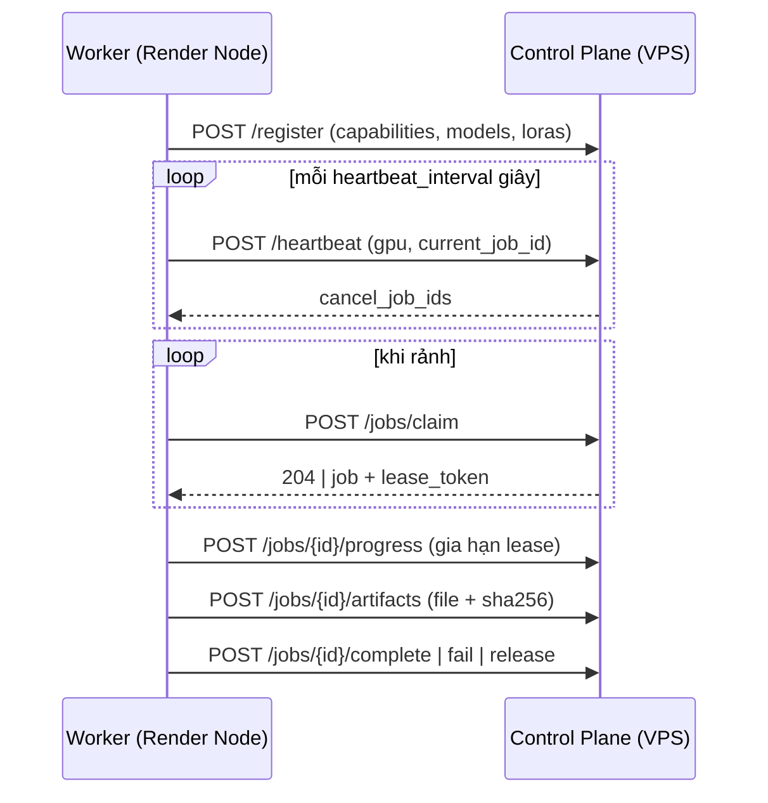
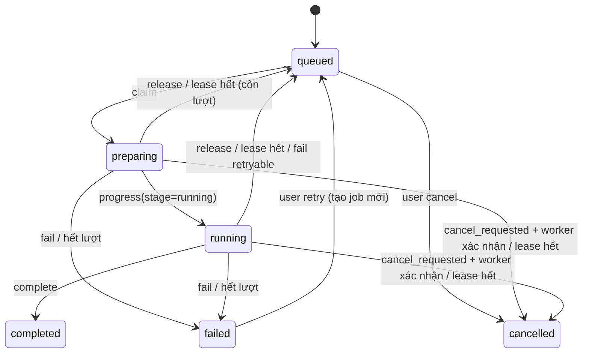

# WORKER_PROTOCOL — Giao thức Render Node ↔ Control Plane

Phiên bản giao thức: `1` (`protocol_version`). Worker luôn **chủ động** gọi tới VPS (pull); VPS không bao giờ gọi vào Render Node.

- Base path: `/api/worker/v1`
- Xác thực: header `Authorization: Bearer <node_token>`. Token do Admin tạo khi thêm node (chỉ hiện một lần, VPS chỉ lưu SHA-256).
- Node bị `disabled` → mọi request trả `403 node_disabled`.
- Lỗi luôn có dạng `{"error": {"code": "...", "message": "..."}}`.
- Thời gian: chuỗi UTC `YYYY-MM-DDTHH:MM:SS.sssZ`. ID: chuỗi UUID.

## Vòng đời



## Endpoints

### `POST /register`
Gọi khi worker khởi động (`fresh_start: true`) và gọi lại định kỳ để cập nhật capabilities (`fresh_start: false`).

```json
{
  "protocol_version": 1,
  "worker_version": "0.1.0",
  "fresh_start": true,
  "job_types": ["generate"],
  "engines": [{"name": "mock", "version": "1", "capabilities": ["generate"]}],
  "models": [{"engine": "mock", "key": "mock-v1", "name": "Mock Engine v1", "capabilities": ["generate"]}],
  "loras": [],
  "datasets": [{"key": "lofi-jazz/v1", "name": "lofi-jazz", "samples": 40, "seconds": 2400.0}],
  "gpu": {"name": "NVIDIA GeForce RTX 3060", "vram_total_mb": 12288}
}
```

- `job_types`: node train được thì thêm `"train_lora"`.
- `datasets` (tùy chọn): dataset version có trên đĩa của node. Có trường này thì danh sách của node được **thay thế**; không gửi thì giữ nguyên (worker cũ).

- `loras`: danh sách `key` của LoRA có trên node (chuỗi). LoRA không có trong Registry bị bỏ qua.
- `models[].engine`: `captioner` → model lưu với `kind = captioner`, `scorer` → `kind = scorer`, còn lại `kind = generator`. Chỉ `generator` dùng được để tạo nhạc.
- Model chưa có trong Registry được tự thêm (`status: active`); bảng installations của node được **thay thế** bằng danh sách vừa báo.
- `fresh_start: true` → mọi job node này đang giữ (`preparing`/`running`) được trả về hàng đợi (hoặc `failed` nếu hết lượt thử, `cancelled` nếu đã yêu cầu hủy).
- `protocol_version` không được hỗ trợ → `409 protocol_mismatch`.

Trả về: `{"node_id": "...", "name": "render-node-01", "heartbeat_interval": 15, "lease_seconds": 90, "poll_interval": 3}`

### `POST /heartbeat`
```json
{"current_job_id": null, "gpu": {"utilization": 0.0, "vram_used_mb": 512, "vram_total_mb": 12288}}
```
Cập nhật `last_seen`; nếu `current_job_id` là job node đang giữ thì lease được gia hạn.
Nếu node không có job `lora_files` nào `queued`/`preparing`/`running`, API còn tìm trong các LoRA đã train trên node đó: bản `kept` quá `expires_at` (chưa đánh dấu), hoặc bản có `delete_requested_at` cũ hơn 1 ngày mà chưa `deleted` (job xóa trước đó hỏng; kể cả LoRA đã `archived`). Đánh dấu lại và tạo một job `lora_files` `op=delete` cho LoRA đầu tiên (theo hạn); lần heartbeat sau khi job còn chờ không tạo thêm. Bản `chosen` không bao giờ bị dọn.
Trả về: `{"cancel_job_ids": ["..."], "maintenance": false}` — job nào nằm trong `cancel_job_ids` worker phải dừng rồi gọi `fail` với `cancelled: true`.

### `POST /jobs/claim`
Body `{}`. Trả `204` nếu không có job phù hợp, hoặc:

```json
{
  "id": "…", "type": "generate", "attempt": 1,
  "lease_token": "…", "lease_expires_at": "…",
  "payload": { }
}
```

Điều kiện để một job được giao cho node (kiểm tra nguyên tử trong một câu lệnh SQL):
1. Job `queued`; node `active`, không `maintenance`.
2. Node **không** đang giữ job nào (V1: một GPU job mỗi node).
3. `job.type` ∈ `job_types` của node.
4. Model yêu cầu đã cài trên node; LoRA yêu cầu (nếu có) đã có trên node.
5. Job có `payload.node_id` chỉ được giao cho đúng node đó (job không có thì giao cho node nào cũng được). Dùng cho `eval_lora`, nơi bản lưu nằm trên node đã train.
6. Ưu tiên `priority` cao hơn, rồi tới job cũ hơn. Bảng ưu tiên: `lora_files` 10 (kế hoạch), `generate` 0, `analyze_track` -10, `caption_tracks` -20, `eval_lora` -30, `train_lora` tạo từ bản chụp -40 (job kiểu cũ giữ 0).

Sau khi claim: job chuyển `preparing`, `attempt` tăng 1.

### `POST /jobs/{id}/progress`
```json
{"lease_token": "…", "progress": 0.42, "stage": "running", "message": "diffusion 12/27",
 "phase": "training", "metrics": [{"sequence": 7, "global_step": 7, "epoch": 4, "train_loss": 0.9022,
   "learning_rate": null, "elapsed_seconds": 23.7, "gpu_memory_mb": 5062}]}
```
- `progress` 0..1. `stage`: `preparing` | `running` (lần đầu gửi `running` thì job chuyển `preparing → running`).
- `message` được nối vào log của job (tối đa giữ 64 KB cuối).
- `phase` (tùy chọn): tên pha của job dài, được lưu vào `stage` thay cho `running`.
- `metrics` (tùy chọn, mảng): sự kiện training, lưu theo `(job, sequence)`; gửi lại cùng `sequence` không tạo bản ghi trùng. Giá trị trainer không có thì gửi `null`.
- Gia hạn lease. Trả về `{"cancel_requested": false}`.
- Sai `lease_token` hoặc job không còn thuộc node → `409 lease_lost`: worker phải bỏ job, **không** upload kết quả.

### `GET /jobs/{id}/inputs/{artifact_id}?lease_token=…`
Tải một file đầu vào của job (Reference Audio / Source Audio). Chỉ trả file khi node đang giữ job (`preparing`/`running`, đúng `lease_token`) và `artifact_id` nằm trong `payload.inputs`; sai lease → `409 lease_lost`, không thuộc job → `404`. Worker phải so SHA-256 với `payload.inputs.*.sha256`.

### `POST /jobs/{id}/artifacts` (multipart)
Fields: `lease_token`, `kind` (`audio_master` | `audio_preview`, hoặc `eval_00`…`eval_99` cho job `eval_lora`: khớp `^eval_[0-9]{2}$`, chỉ file `.mp3`, lưu `audio/mpeg`; dùng cho job khác hoặc sai đuôi → `422`), `sha256` (hex của file), `file`.
VPS tự tính lại SHA-256; lệch → `422 checksum_mismatch` (worker thử lại). Upload lại cùng `kind` cho cùng job sẽ thay bản cũ (idempotent).
Trả về: `{"artifact_id": "…"}`.

### `POST /jobs/{id}/complete`
```json
{"lease_token": "…", "result": {"seed": 123, "duration": 120.0, "sample_rate": 48000, "engine": "mock", "model_key": "mock-v1", "engine_info": {}}}
```
Job `generate` bắt buộc đã có artifact `audio_master`, nếu không → `422 missing_artifact`. VPS tạo Track trong cùng transaction. Gọi lại `complete` cho job đã `completed` với đúng token trả `200` (idempotent).

### `POST /jobs/{id}/fail`
```json
{"lease_token": "…", "error": "mô tả lỗi", "retryable": false, "cancelled": false}
```
- `cancelled: true` (đáp lại yêu cầu hủy) → `cancelled`.
- `retryable: true` và còn lượt thử → về `queued`; ngược lại → `failed`.

### `POST /jobs/{id}/release`
`{"lease_token": "…"}` — worker tắt có kiểm soát, trả job về `queued` ngay (không tính là thất bại, hoàn lại lượt thử).

## Payload job `generate`

```json
{
  "prompt": "caption cuối cùng gửi cho engine",
  "duration": 120,
  "seed": 123456,
  "bpm": 80, "key": "A minor", "time_signature": "4/4",
  "model": {"id": "…", "engine": "mock", "key": "mock-v1"},
  "lora": null,
  "params": {"inference_steps": null, "guidance_scale": null},
  "mode": "text",
  "inputs": {},
  "output": {"formats": ["wav", "mp3"]}
}
```
- `mode`: `text` | `reference` | `cover` (thiếu = `text`). Engine phải có capability tương ứng (`reference_audio`, `cover`); không có thì worker `fail` không retry, không được lặng lẽ chạy như `text`.
- `inputs`: `{}` hoặc `{"reference_audio": {"artifact_id", "filename", "size_bytes", "sha256"}}` (mode `reference`) / `{"source_audio": {…}}` (mode `cover`).
- Mode `cover`: `duration` là `null` (độ dài theo Source Audio); `params.audio_cover_strength` 0–1 hoặc không có.
- `seed` luôn do VPS chọn sẵn (không bao giờ -1) để tái lập được.
- `lora`: `null` hoặc `{"id": "…", "key": "…", "scale": 0.7}`.
- `bpm`/`key`/`time_signature` có thể `null`.

## Lease, timeout, phục hồi

- Lease mặc định 90 giây, gia hạn bởi `progress` và `heartbeat` (có `current_job_id`).
- VPS chạy reaper mỗi 10 giây: job `preparing`/`running` hết lease →
  - đã yêu cầu hủy → `cancelled`;
  - còn lượt thử (`attempt < max_attempts`, mặc định 3) → `queued`;
  - hết lượt → `failed` (`error: lease expired`).
- Node `online` khi `last_seen` trong vòng 45 giây. Node offline không ảnh hưởng website; job nằm chờ trong hàng đợi.
- Job đang chạy dở **không** được chuyển sang node khác giữa chừng; nó chỉ được chạy lại từ đầu sau khi lease hết.

## State machine của job



## Job `train_lora` (đang chạy từ M1)

Payload:
```json
{"lora": {"key": "lofi-jazz-v1-039429c0", "name": "Lo-fi Jazz v1"}, "dataset": {"key": "lofi-jazz/v1"},
 "base_model": {"id": "…", "engine": "acestep", "key": "acestep-v15-turbo"}, "trainer": "sidestep",
 "config": {"rank": 32, "alpha": 64, "learning_rate": 0.0001, "epochs": 4, "gradient_accumulation": 4,
            "save_every": 2, "warmup_steps": 2, "seed": 42},
 "limits": {"max_seconds": 1800}}
```
- Claim: job `train_lora` chỉ được giao cho node báo `train_lora` trong `job_types`, và chỉ khi không còn job `generate` nào đang `queued`. Ngoài ra payload phải có `dataset.snapshot_id` (dạng bản chụp, bên dưới) **hoặc** node phải báo `dataset.key` trong `datasets` (dạng cũ).

Dạng bản chụp (LoRA tạo từ catalog, `POST /catalogs/{id}/loras`): giữ nguyên các key trên (`dataset.key` là `lora.key`) và thêm:
```json
{"dataset": {"key": "<lora_key>", "snapshot_id": "<id>"}, "genre": "Lo-fi",
 "samples": [{"input": "t0", "train_caption": "lushlofi, warm rhodes", "bpm": 80, "keyscale": "A minor", "duration_s": 182.4}],
 "inputs": {"t0": {"artifact_id": "…", "filename": "song.wav", "size_bytes": 123, "sha256": "…"}}}
```
`samples` chỉ gồm bài train (bài giữ lại nằm trong bản chụp, không nằm trong payload). `bpm`/`keyscale` có thể `null`. Worker tải từng file qua `GET /jobs/{id}/inputs/{artifact_id}?lease_token=…`; node không cần dataset sẵn. Nội dung đầy đủ và bất biến của lần chọn nằm ở `dataset_snapshots` (`GET /dataset-snapshots/{id}`), `config.max_duration_s = 240` ở đó là mức cắt bài dài khi train.
- Dạng bản chụp, phía worker: tải và kiểm SHA-256 từng input (sai thì `fail`, không train), báo `phase: preparing_dataset` (progress 0.01), rồi đổi mỗi file sang WAV 48 kHz stereo bằng ffmpeg và ghi dataset Side-Step vào `datasets/<lora_key>` (qua `.partial` rồi rename; `duration` cắt ở 240 s; bỏ hẳn `bpm`/`keyscale` khi null; `custom_tag` rỗng). Việc này chạy **trước** khi dừng inference server, nên thiếu ffmpeg hay file hỏng thì job `fail` mà inference vẫn chạy. Dataset đã có trên node thì `fail`, không bao giờ ghi đè.
- `max_attempts = 1`. Worker không bao giờ `release` một training run (kể cả khi bị tắt): nó gọi `fail`.
- Worker dừng inference server trước khi train và bật lại sau đó trong mọi trường hợp; node không nhận job khác trong lúc này (một job mỗi node).
- `complete` phải có `result.lora.adapter_sha256`, thiếu thì `422 missing_artifact`. Với job dạng bản chụp (payload có `dataset.snapshot_id`), `result.checkpoints` là bắt buộc: `[{epoch (≥1), step (int|null), path (không rỗng), sha256 (64 ký tự hex thường), bytes (int)}]`. Rỗng/thiếu → `422 missing_artifact "Job train_lora chưa báo checkpoint"`; phần tử sai → `422 "checkpoint không hợp lệ"`; cả hai kiểm trước mọi câu ghi nên job vẫn chạy. Control Plane ghi `loras.snapshot_id`, `dataset_key = lora.key` và mỗi checkpoint vào `lora_checkpoints` (`status kept`) trong cùng transaction; `path` chỉ lưu ở `node_path` và bị bỏ khỏi `jobs.result`. Job kiểu cũ bỏ qua `checkpoints`. Control Plane tạo dòng `loras` (`status: evaluation`) và ghi node là nơi có LoRA. Adapter không được tải lên VPS (D9).
- Worker báo `result.checkpoints` cho mọi run `train_lora` (cả kiểu cũ), sắp theo `epoch` tăng, mỗi epoch một phần tử: `step` là số optimizer step tại dòng `[OK] Checkpoint saved at epoch N` (null nếu không biết), `path` tuyệt đối, `sha256` của `adapter_model.safetensors`, `bytes` là tổng dung lượng thư mục. Run `completed` mà epoch cuối chưa có checkpoint thì thêm `out/final` với `epoch = epochs_completed`; run dừng vì `time_limit` chỉ báo các checkpoint đã có. Với bản chụp, worker kiểm checkpoint nền và `LORA_DIR` trước khi dựng dataset nên lỗi điều kiện không để lại dataset trên đĩa.
- Sau khi kết thúc run, worker `register` lại ngay (`fresh_start: false`) để báo model và LoRA mới.
- Job dạng bản chụp có `priority = -40`. Khi `complete` thành công, cùng transaction tạo job `eval_lora` (bên dưới); không tạo khi job `fail`/cancel hoặc là job kiểu cũ. Nếu dựng payload render không hợp lệ (ví dụ model gốc bị tắt) thì bỏ qua job nghe thử, LoRA vẫn được ghi.

## Job `eval_lora`

Tạo tự động khi `train_lora` dạng bản chụp hoàn tất, ghim vào node đã train (`payload.node_id`, xem điều kiện claim số 5). Chủ job là người tạo bản chụp, `priority = -30`, `max_attempts = 2`, `title` = `Nghe thử <tên LoRA>`, không gắn `model_id`/`lora_id`. Chỉ giao cho node báo `eval_lora` trong `job_types`. Job ghim vào một node không bao giờ quay lại vẫn ở trạng thái `queued` cho đến khi admin hủy nó. Worker xử lý nằm ở các task sau của P3.

Kết quả `complete` (API đã xử lý; tên `artifact_kind` là `eval_NN` đã upload cho chính job này):

Payload:
```json
{"node_id": "…", "lora": {"id": "…", "base_key": "<lora_key>"},
 "dataset_key": "<lora_key>", "scale": 0.7, "duration": 60, "seed": 123,
 "render_template": { "prompt": "…", "duration": 60, "seed": 123, "model": {…}, "lora": null, "params": {…}, "mode": "text", "output": {…} },
 "test_prompt": "…",
 "checkpoints": [{"id": "…", "epoch": 4, "key": "<lora_key>-e4", "path": "<đường dẫn trên node>", "sha256": "…"}],
 "train": [{"dataset_file": "s000.wav", "filename": "late_bus_home.mp3"}],
 "held_out": [{"filename": "rainy_window.mp3", "prompt": "<train_caption>"}]}
```
- `render_template` là payload `generate` do cùng hàm dựng như tạo nhạc thường (model gốc, tham số, mẫu prompt theo genre của catalog; không LoRA; `seed` = `config.seed` của bản chụp). Mọi câu lệnh render đã được ghép sẵn bằng cùng một đường như tạo nhạc thường (mẫu genre, thẻ, `instrumental, no vocals`): `test_prompt`, `render_template.prompt` (bằng `test_prompt`) và `held_out[].prompt`. Worker đặt `prompt` của render **nguyên văn** từ các giá trị này (và thay `lora`), không tự ghép gì thêm.
- `duration`: 60 giây, kẹp vào khoảng `duration_min`–`duration_max` của genre khi khoảng đó có đủ hai đầu; giá trị thật dùng nằm ở `duration` và `render_template.duration`. `scale` = 0.7.
- `checkpoints`: tối đa 10 bản lưu chưa xóa có epoch lớn nhất, sắp theo epoch tăng. `key` = `<lora_key>-e<epoch>` (mỗi epoch một khóa adapter riêng). `path` chỉ có trong payload gửi node, không bao giờ ra web.
- `train[i].dataset_file` = `s<i:03>.wav` trong `datasets/<lora_key>` (thứ tự bài train của bản chụp); `held_out[].prompt` = `train_caption` của bài giữ lại, đã ghép như trên; caption quá dài bị cắt ở khoảng trắng cuối trước giới hạn (không thêm dấu ba chấm) để câu lệnh đã ghép không vượt 2000 ký tự.
```json
{"renders": [{"artifact_kind": "eval_00", "kind": "base", "checkpoint_id": null, "sample_filename": null,
              "prompt": "...", "scores": {"mert_style": null, "mert_train": null, "train_match": null,
                                          "melody": 0.41, "melody_match": "late_bus_home.mp3", "quality": null}}],
 "checkpoints": [{"id": "...", "style": 0.82, "train": 0.71, "train_match": "a.mp3",
                  "melody": 0.44, "melody_match": "b.mp3", "quality": 6.9}],
 "scorers": {"mert": false, "audiobox": false}}
```
- `renders[].kind` là `base` (không LoRA, `checkpoint_id` null), `prompt` (câu `test_prompt`) hoặc `held_out` (kèm `sample_filename`). Mỗi `artifact_kind` xuất hiện một lần. `scores` của render được lưu nguyên (object, null giữ null).
- `checkpoints[]` ghi điểm tổng hợp lên bản lưu: `style`→`style_score`, `train`→`train_score`, `train_match`, `melody`→`melody_score`, `melody_match`, `quality`→`quality_score`. Điểm `null` (máy chấm chưa cài) giữ `null`. `scorers` báo máy chấm nào đã chạy; API lưu trong `result` và trả ra web ở `eval.scorers` (thiếu = `false`).
- Kiểm trước khi ghi, sai bất kỳ điều gì → `422 "kết quả đánh giá không hợp lệ"`, **không ghi gì** và job vẫn đang chạy: `renders` không phải mảng, `artifact_kind` không phải `eval_NN` hoặc chưa được upload cho job này, trùng `artifact_kind`, `kind` lạ, `prompt` thiếu, `checkpoint_id` không thuộc LoRA `payload.lora.id`, điểm không phải số hữu hạn hoặc null.

## Thử nhanh (job `generate` có `payload.lora.path`)

`POST /loras/{id}/try` tạo job `generate` thường (`model_id` = model gốc, `jobs.lora_id` NULL, nên không cần `lora_installations`) và ghim vào node đã train bằng `payload.node_id`. Khác job tạo nhạc thường ở `payload.lora = {"key": "<base_key>-e<epoch>", "scale": 0.0–1.0, "path": "<đường dẫn bản lưu trên node>"}`: `key` theo khóa adapter của epoch (từ `COALESCE(loras.base_key, loras.key)`, không phải `loras.key` hiện tại), `path` là `lora_checkpoints.node_path` và chỉ có trong payload gửi node. Worker nạp adapter theo `path` (chỉ dưới thư mục train, như `eval_lora`); `key` là tên adapter đã nạp.

## Job `lora_files`

Thao tác file trên node, không dùng GPU. Tạo bởi API (không bởi worker): `POST /loras/{id}/publish` (`op=publish`), `POST /loras/{id}/cleanup`, `DELETE /loras/{id}` và heartbeat dọn bản hết hạn (`op=delete`). Chủ job là người tạo LoRA, `priority = 10`, `max_attempts = 2`, ghim vào node đã train (`payload.node_id`), không gắn `model_id`/`lora_id`. Chỉ giao cho node báo `lora_files` trong `job_types`. Mọi payload đều có `node_id`, `lora_id` và `lora: {"id": "…"}` (cùng giá trị).

Payload `publish`: chép bản lưu đã chọn thành thư mục adapter `LORA_DIR/<target_key>` (không xóa thư mục của bản đưa vào trước):
```json
{"node_id": "…", "lora_id": "…", "lora": {"id": "…"}, "op": "publish",
 "target_key": "<lora_key>-e<epoch>",
 "checkpoint": {"id": "…", "path": "<đường dẫn trên node>", "sha256": "…"}}
```
Kết quả `complete`: `{"published": {"key": "<target_key>", "sha256": "…"}}`. `key` phải bằng `target_key` và `sha256` bằng `checkpoint.sha256`, sai → `422`, **không ghi gì** và job vẫn đang chạy. Đúng thì cùng transaction (đây mới là lúc việc chọn có hiệu lực, `publish` của API chưa đổi gì ngoài Style): bản chọn `chosen`, các bản khác `kept` với `expires_at` = bây giờ + 30 ngày (giữ hạn đã có), `loras.key` = `target_key`, `base_key` ghi lại khóa gốc, `chosen_checkpoint_id`, `status = 'approved'`, `lora_installations` đặt lại chỉ còn `(node, lora)`, Style `trained` của LoRA bật (`is_active = 1`).

Payload `delete`: xóa thư mục các bản lưu (chỉ dưới thư mục train của node):
```json
{"node_id": "…", "lora_id": "…", "lora": {"id": "…"}, "op": "delete",
 "checkpoints": [{"id": "…", "path": "<đường dẫn trên node>"}]}
```
Kết quả `complete`: `{"deleted": ["<checkpoint_id>"], "missing": ["<checkpoint_id>"]}`; cả hai nhóm (`missing` = đã không còn trên node) chuyển bản lưu sang `status = 'deleted'`. Id không nằm trong `payload.checkpoints` hoặc sai kiểu → `422`, không ghi gì.

Phía worker: node chỉ báo `lora_files` trong `job_types` khi có trainer (cùng `train_lora`). Mọi `path` (đã `resolve`) phải có dạng `<DATA_DIR>/training/<job>/out/checkpoints/<tên>` hoặc `<job>/out/final`, sai → job `fail` không retry và **không xóa/chép gì** (`delete` kiểm hết rồi mới xóa). `publish` kiểm SHA-256 của `adapter_model.safetensors` bằng `checkpoint.sha256`, chép `adapter_config.json` + `adapter_model.safetensors` vào `LORA_DIR/<target_key>.partial` rồi đổi tên; `target_key` đã có cùng SHA → thành công ngay (idempotent, API được gửi lại), khác SHA → lỗi, không ghi đè. `target_key` khớp `^[A-Za-z0-9][A-Za-z0-9._-]{0,127}$`. Sau `complete` worker đăng ký lại để `loras` có khóa mới ngay. Với `generate` mang `lora.path`, engine ACE-Step áp cùng quy tắc: path ngoài thư mục train hoặc thiếu `adapter_config.json` → `AceStepError("LoRA path is outside the training directory")`, không gọi `/v1/lora/load`.

Khi job `lora_files` `fail`: `publish` không để lại gì dở (key, bản chọn, `lora_installations` giữ nguyên, bản đang chạy vẫn phục vụ; người dùng bấm lại `publish` để thử lại); `delete` để lại bản đã đánh dấu mà chưa `deleted`, được chọn lại khi bấm "Xóa ngay" hoặc sau 1 ngày bởi heartbeat. Web đọc lỗi từ `files_job`. Tại mọi thời điểm mỗi LoRA có tối đa một job `lora_files` `queued`/`preparing`/`running` (chỉ mục duy nhất `jobs_one_live_lora_files` trên `payload.lora_id`).

## Job `analyze_track`

Tạo khi người dùng tải một bài vào catalog (`POST /catalogs/{id}/tracks`). Chỉ giao cho node báo `analyze_track` trong `job_types`.

Payload (input tải qua `GET /jobs/{id}/inputs/{artifact_id}` như mọi input):
```json
{"catalog_track_id": "…", "inputs": {"track": {"artifact_id": "…", "filename": "Rainy Day.wav", "size_bytes": 123, "sha256": "…"}}}
```
- `priority = -10` (sau `generate` = 0, trước `caption_tracks` = -20), `max_attempts = 3`, `title` = tên file.
- `result` của `complete`:
```json
{"duration_s": 123.5, "tempo": {"bpm": 78.0, "confidence": 0.82, "alternatives": [156.0]},
 "key": {"key": "D minor", "confidence": 0.61}, "loudness_lufs": -14.2, "clipping": false, "silence_ratio": 0.03}
```
  `tempo.bpm`, `key.key`, `loudness_lufs` có thể là `null`.
- Control Plane lưu toàn bộ `result` vào `analysis`, đặt `analysis_status = done` và `duration_s`. `tempo_bpm` / `key_name` (với `*_source = auto`) chỉ được ghi khi giá trị khác `null` **và** nguồn hiện tại không phải `human`, trong một câu `UPDATE` chỉ khớp khi `analysis_job_id` của track đúng là job này (job cũ sau khi phân tích lại không ghi đè). `result.duration_s` phải là số ≥ 0, nếu không `422`.
- Không có ghi riêng khi job `failed`/`cancelled`: `analysis_status = failed` được suy ra khi đọc từ trạng thái job.

## Job `caption_tracks`

Tạo bởi `POST /catalogs/{id}/caption-jobs`: mô tả một hoặc nhiều bài của catalog bằng một model captioner. Chỉ giao cho node báo `caption_tracks` trong `job_types` **và** có model trong `model_installations` (`jobs.model_id` = id model; claim không cần điều kiện riêng).

Payload (input tải qua `GET /jobs/{id}/inputs/{artifact_id}`):
```json
{"catalog_id": "…", "model": {"id": "…", "key": "moss-music-8b-instruct"},
 "tracks": [{"catalog_track_id": "…", "input": "t0"}],
 "inputs": {"t0": {"artifact_id": "…", "filename": "Rainy Day.wav", "size_bytes": 123, "sha256": "…"}}}
```
- `priority = -20` (thấp nhất), `max_attempts = 2`, `title` = `Mô tả N bài · <tên model>`.
- Worker gửi **từng bài ngay khi xong** (không chờ hết job) để job bị hủy/lỗi giữa chừng vẫn giữ kết quả đã có:

`POST /api/worker/v1/jobs/{id}/captions`
```json
{"lease_token": "…", "catalog_track_id": "…", "mood": "calm", "instruments": "piano", "vocals": "Instrumental",
 "caption": "…", "source_ref": "tên/phiên bản prompt hoặc run"}
```
→ `200 {"revision_seq": 1}`.
- Kiểm lease như `progress` (sai lease, job không còn `preparing`/`running`, hoặc không phải job `caption_tracks` → `409 lease_lost`). `catalog_track_id` không có trong `payload.tracks` → `404`.
- Ghi một lượt `source = model` (`job_id` = job, `created_by` = chủ job, `model_key` = `payload.model.key`, `seq = max + 1`) và đặt head vào lượt đó, cùng đường code với khi người dùng lưu tay.
- **Idempotent**: gửi lại cùng (job, bài) trả lại `revision_seq` của lượt đầu, không thêm lượt, không dời head (chỉ mục unique `(job_id, catalog_track_id)`).
- Báo lỗi một bài: `{"lease_token": "…", "catalog_track_id": "…", "error": "…"}` (có trường `error` là báo lỗi). Không tạo lượt; ghi `"<filename>: <error>"` vào `message` và log job (log vẫn giới hạn 64 KB) → `200 {"revision_seq": null}`. Job vẫn tiếp tục các bài còn lại.
- `complete`: không có xử lý riêng, chỉ lưu `result`: `{"done": n, "failed": ["catalog_track_id", …]}`.
- Hủy: website đặt `cancel_requested`, worker xác nhận bằng `fail(cancelled)` như mọi job. Các bài đã có lượt giữ nguyên; bài chưa xong thôi hiện "đang tạo" vì job không còn hoạt động.

### Captioner subprocess

Worker không nhúng model captioner: mỗi model là một script riêng, khai báo trong `CAPTIONER_DIR` (biến môi trường của worker, không đặt thì worker không báo `caption_tracks`):

```
CAPTIONER_DIR/
  <tên>/captioner.json
```
```json
{"key": "moss-music-8b-instruct", "name": "MOSS Music 8B", "version": "1",
 "python": ".venv/bin/python", "script": "caption.py", "mode": "json", "prompt": "(tùy chọn)"}
```
- `python`, `script`: đường dẫn tuyệt đối hoặc tương đối với thư mục `<tên>/` (`python` không tồn tại dưới dạng file thì dùng như lệnh trong PATH, ví dụ `python3`). `mode`: `json` (model trả JSON 4 khóa) hoặc `text` (model trả một đoạn mô tả; mood/instruments/vocals suy ra từ từ khóa). `prompt` bỏ trống thì `mode=json` dùng prompt mặc định của worker, `mode=text` gửi `null`.
- Cấu hình hỏng bị bỏ qua kèm log cảnh báo. Mỗi captioner hợp lệ được báo khi register như model `{engine: "captioner", key, name, version, capabilities: ["caption"]}`; `caption_tracks` chỉ nằm trong `job_types` khi có ít nhất một captioner.

Giao thức JSON-lines (UTF-8, mỗi dòng một JSON):
- Worker chạy `python script` **một lần mỗi job** (cwd = thư mục `<tên>/`), model nạp một lần cho cả job.
- Mỗi bài: worker ghi vào **stdin** `{"id": "<catalog_track_id>", "audio": "<đường dẫn file>", "prompt": "<prompt|null>"}`.
- Script trả một dòng trên **stdout**: `{"id": "…", "text": "…"}` hoặc `{"id": "…", "error": "…"}`. Dòng không phải JSON hoặc khác `id` bị bỏ qua. Mọi log đi **stderr**.
- Kết thúc job: worker đóng stdin; script thoát. Hủy job: terminate, sau 5 giây thì kill.
- Timeout 600 giây mỗi bài (quá hạn: kill tiến trình, ghi lỗi cho bài đó).
- Kết quả không dùng được (JSON hỏng/rỗng) thì gửi lại đúng bài đó một lần; vẫn hỏng thì dùng nguyên văn làm `caption` (nếu không rỗng) và `mood`/`instruments`/`vocals` rút từ nguyên văn đó bằng từ khóa (không để trống); câu trả lời rỗng thì báo lỗi bài đó. Tiến trình chết giữa chừng: bài đang làm báo lỗi, worker khởi động lại một lần rồi đi tiếp; chết lần nữa thì job `fail` không retry.
- Payload có `model.key` không khớp captioner nào trên máy: `fail` không retry, "Captioner <key> không có trên máy này".

## Đề xuất mở rộng cho training — CHƯA triển khai

Mọi thứ phía trên mục này là hợp đồng **đang chạy** (protocol `1`). Mục này chỉ là đề xuất từ `STYLE_TRAINING.md` (mục 12), chưa có trong API hay worker; không được dựa vào nó khi viết code cho tới khi nó được chuyển lên trên cùng với thay đổi code.

Đã chuyển lên hợp đồng đang chạy ở M1: job type `train_lora`, `phase` và `metrics` trong `progress`, `datasets` trong `register`, thứ tự claim sau job generate. Các mục 1, 4 và một phần mục 2, 5 dưới đây vì vậy đã có; phần còn lại vẫn là đề xuất.

Hiện trạng cần biết:
- Lease là 90 giây cho mọi loại job; job hết lease với `max_attempts = 1` thành `failed` trong khi tiến trình trên node có thể vẫn chạy.

Đề xuất:
1. **Job type `train_lora`**, `max_attempts = 1`. Node báo `job_types` theo cấu hình thật.
2. **Tách ba tín hiệu:**
   - *Heartbeat* (node còn sống): như hiện tại, thêm `activity` (`idle` | `generating` | `training` + run, thời điểm bắt đầu) để web hiện node đang train.
   - *Lease* (quyền thực thi một attempt): độ dài theo loại job, do VPS trả về khi claim; job train dùng lease dài hơn để chập mạng ngắn không giết run.
   - *Training progress* (số liệu): `progress` nhận thêm `stage` tự do và `metrics[]` (`sequence`, `global_step`, `epoch`, `train_loss`, `learning_rate`, `elapsed_seconds`, `gpu_memory_used`). Mất vài lô metrics không ảnh hưởng lease.
3. **Chống chạy trùng một run** (không chỉ tăng timeout):
   - Mỗi lần claim sinh `lease_token` mới gắn với `attempt`; mọi lệnh ghi (`progress`, `artifacts`, `complete`, đăng ký checkpoint) phải mang token của attempt hiện hành, sai token trả `409 lease_lost` như hiện tại.
   - Worker nhận `409` phải dừng trainer ở ranh giới an toàn và không đăng ký thêm gì.
   - Một run chỉ có một attempt ở `preparing`/`running`; attempt mới (resume) chỉ tạo được khi attempt cũ đã kết thúc phía VPS **và** node nhận attempt mới xác nhận không còn tiến trình trainer của run đó (pidfile + `run.json` trên node).
   - Thư mục checkpoint theo attempt, nên attempt cũ còn sống cũng không ghi đè attempt mới.
4. **Thứ tự claim:** job train chỉ được claim khi không còn job generate ở `queued`, và trong khung giờ Admin cho phép.
5. **Register:** node báo thêm dataset version có trên đĩa, SHA-256 checkpoint base, commit ACE-Step.
